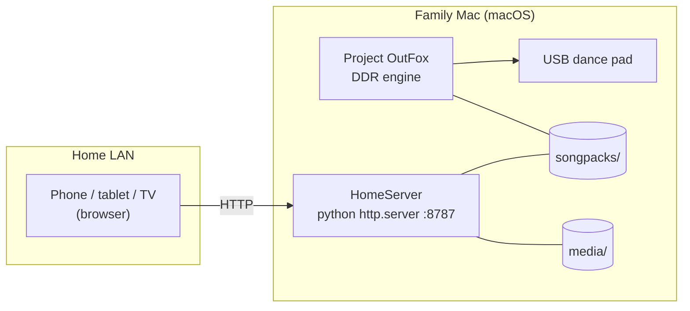

# HomeDDR + HomeServer

[](LICENSE)
[]()
[]()

> A kid-friendly **Dance Dance Revolution / rhythm station** on a family Mac
> (Project OutFox + USB dance pad), plus a tiny **HomeServer** that publishes the
> song library and karaoke media to the home LAN.

**Status:** 🟡 Scaffolded. The repo, HomeServer, and docs exist. Nothing is
installed on the Mac yet, and no hardware has been bought.

---

## What this is

Two parts that share one box:

1. **HomeDDR** — a DDR setup for a 5-year-old who loves dancing and singing.
   [Project OutFox](https://projectoutfox.com/) (free, open-source, StepMania-based)
   drives a cheap USB dance pad. Song packs are curated for kids, with low
   difficulties, and can include custom charts for her favourite music.
2. **HomeServer** — a dependency-free Python static server that exposes the song
   packs and karaoke/audio media to phones, tablets, and TVs on the LAN, with a
   simple landing page and a health endpoint.

The point: no console, no subscription, no per-song purchases. One Mac + one pad +
free software, and a small local server so the whole house can reach the library.

---

## TL;DR

| | |
|---|---|
| **Target machine** | Family Mac (currently Intel `x86_64`, macOS 26.5.2, 16 GB) |
| **DDR engine** | **Project OutFox** — free, StepMania-based, macOS builds |
| **Input** | USB dance pad (soft pad ~$32–$60 CAD; metal pad later) |
| **Song content** | Free/community packs + optional custom charts (Alvin & the Chipmunks, etc.) |
| **HomeServer** | Python 3 stdlib `http.server`, no dependencies |
| **Server default** | `http://127.0.0.1:8787` (LAN: set `HOMEDDR_HOST=0.0.0.0`) |
| **Cost** | ~$32–$60 CAD for the pad; software is free |

---

## Why

- She **loves dancing and singing**, plus **Alvin and the Chipmunks**.
- There is **no good DDR solution** in the house today.
- A Mac is already available, so a software DDR engine + dance pad is the shortest
  path to a real, replayable gift.
- Official DDR titles do not ship for macOS, and "Just Dance" is not native to Mac,
  which is exactly why the OutFox route matters.

> **Note:** "Lou Williams" is a **children's author** (corrected 2026-11-05 — not
> the NBA player). Specific titles are still TBD; see [HANDOFF.md](HANDOFF.md).

---

## Architecture



**Flow**

1. The dance pad is plugged in over USB; OutFox sees it as arrow-key input.
2. Players pick a song pack and chart in OutFox; low difficulties for a 5-year-old.
3. The HomeServer serves the same `songpacks/` and `media/` over the LAN so phones
   and TVs can browse or download them.

---

## Current facts (verified)

Labeled per the project's evidence discipline (see `AGENTS.md`):

- **FACT** — host Mac is `x86_64` (Intel), macOS `26.5.2`, 16 GB RAM.
- **FACT** — Python `3.14.6`, Node `25.5.0`, git, `gh` (logged in), and Homebrew are
  installed.
- **FACT** — OutFox's site lists macOS builds (Intel + Apple Silicon), dance-pad
  support, and standard StepMania `.sm`/`.ssc` song loading. Latest dev build on
  the site: **0.5.0 Final Alpha (2025-09-07)**; legacy **0.4.19 LTS** is marked
  outdated.
- **FACT** — No OutFox/StepMania installation is present in `/Applications` yet.
- **INFERENCE** — OutFox runs on this Intel Mac; a current Intel build should be
  available, but verify against the downloads page at install time.
- **GUESS** — macOS `26.5.2` compatibility is untested for OutFox; expect it to
  work, but confirm.

---

## Quick start

```bash
# 1. Run the HomeServer locally
./scripts/serve.sh                    # http://127.0.0.1:8787

# 2. Expose it to the LAN
HOMEDDR_HOST=0.0.0.0 ./scripts/serve.sh

# 3. (Later) install the DDR engine + pad
./scripts/install-outfox.sh           # opens the official download page

# 4. Point OutFox at the shared song library (after install)
./scripts/link-songpacks.sh
```

---

## Repository layout

```
.
├── README.md                 # this file
├── HANDOFF.md                # state + resume prompt for the next session
├── AGENTS.md                 # project rules (evidence discipline)
├── LICENSE
├── docs/
│   ├── ddr-setup.md          # OutFox + pad + kid difficulty + custom songs
│   └── homeserver.md         # HomeServer usage and security notes
├── homeserver/
│   └── server.py             # dependency-free static server + landing page
├── scripts/
│   ├── serve.sh              # wrapper: run HomeServer
│   ├── install-outfox.sh     # guided OutFox install
│   └── link-songpacks.sh     # symlink shared song library into OutFox
├── launchd/
│   └── com.local.homeddr.plist  # keep HomeServer running at login
├── songpacks/                # OutFox packs (.sm/.ssc) — gitignored
└── media/                    # karaoke/audio — gitignored
```

---

## Roadmap / open decisions

- [ ] Confirm the "Lou Williams" reference.
- [ ] Choose pad: cheap soft pad (~$32–$60) vs metal L-TEK (~$150+, ships from EU).
- [ ] Install OutFox on the family Mac and verify it launches on macOS 26.5.2.
- [ ] Curate kid-friendly song packs; confirm low-difficulty charts exist.
- [ ] Decide whether to author custom Alvin & the Chipmunks charts (manual work).
- [ ] Put the HomeServer behind the existing homelab Caddy reverse proxy?
- [ ] Add HomeServer to `mac-studio-ai-homeserver` when the Mac Studio is built.
- [ ] Budget for a second pad (2-player) or a metal pad later.

---

## Evidence & sources

- Project OutFox — <https://projectoutfox.com/> (macOS builds, dance-pad support,
  version info)
- OutFox wiki — <https://outfox.wiki/>
- OutFox GitHub — <https://github.com/TeamRizu/OutFox>
- Candidate pads (CAD, price at time of writing):
  OSTENT USB pad $31.99, Domary pad $38.60 — see `HANDOFF.md`.

Prices and availability move — re-check before buying.

---

## License

MIT — see [LICENSE](LICENSE).
